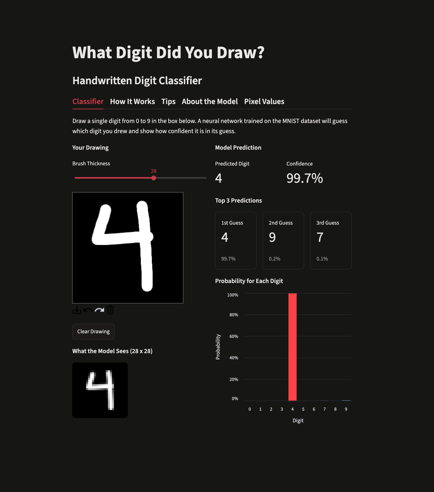
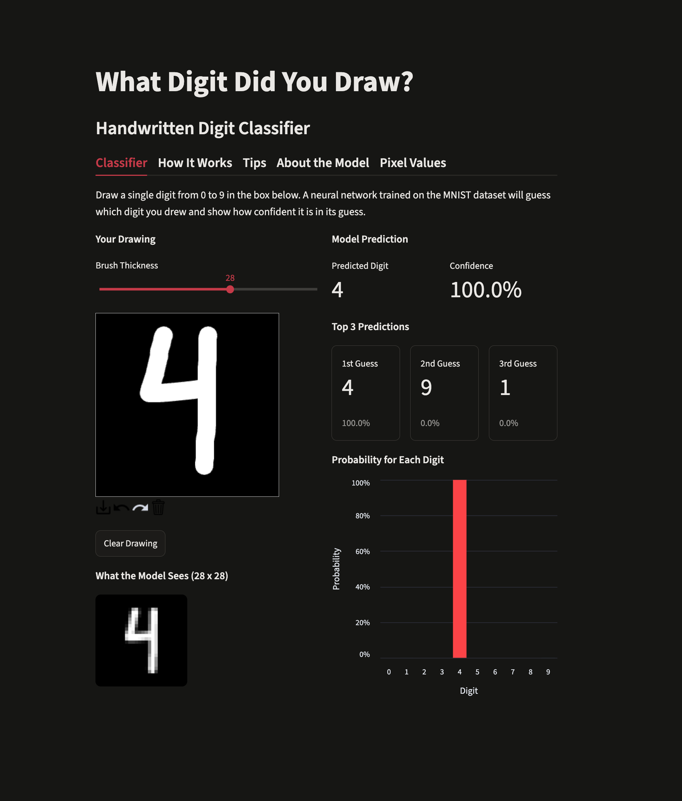
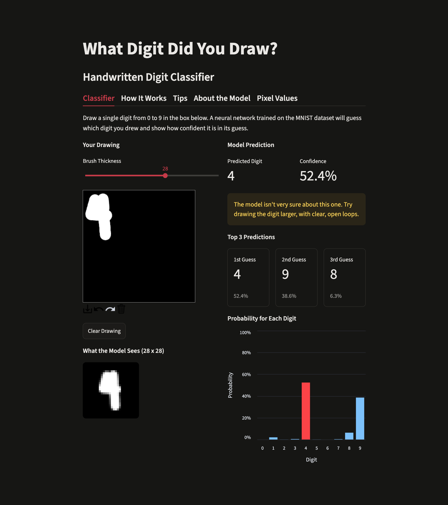
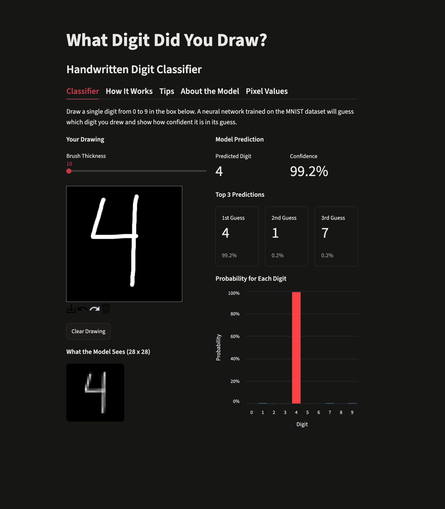
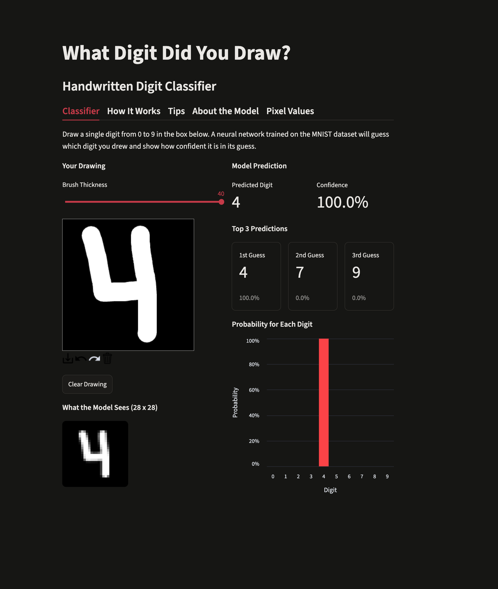
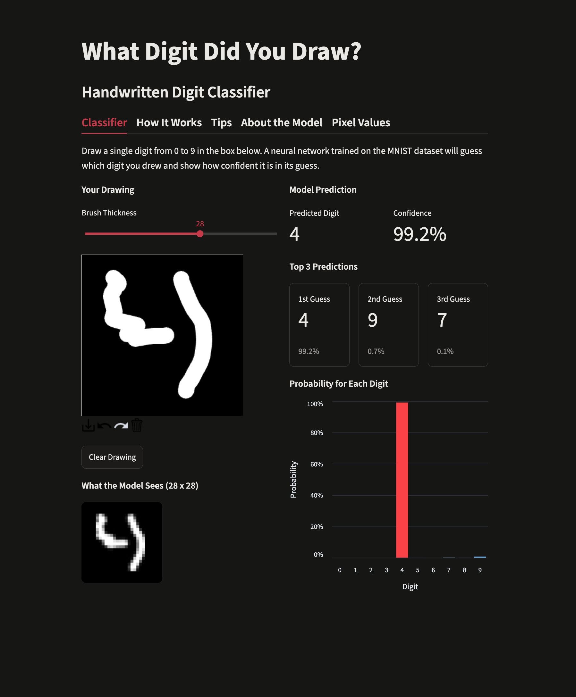
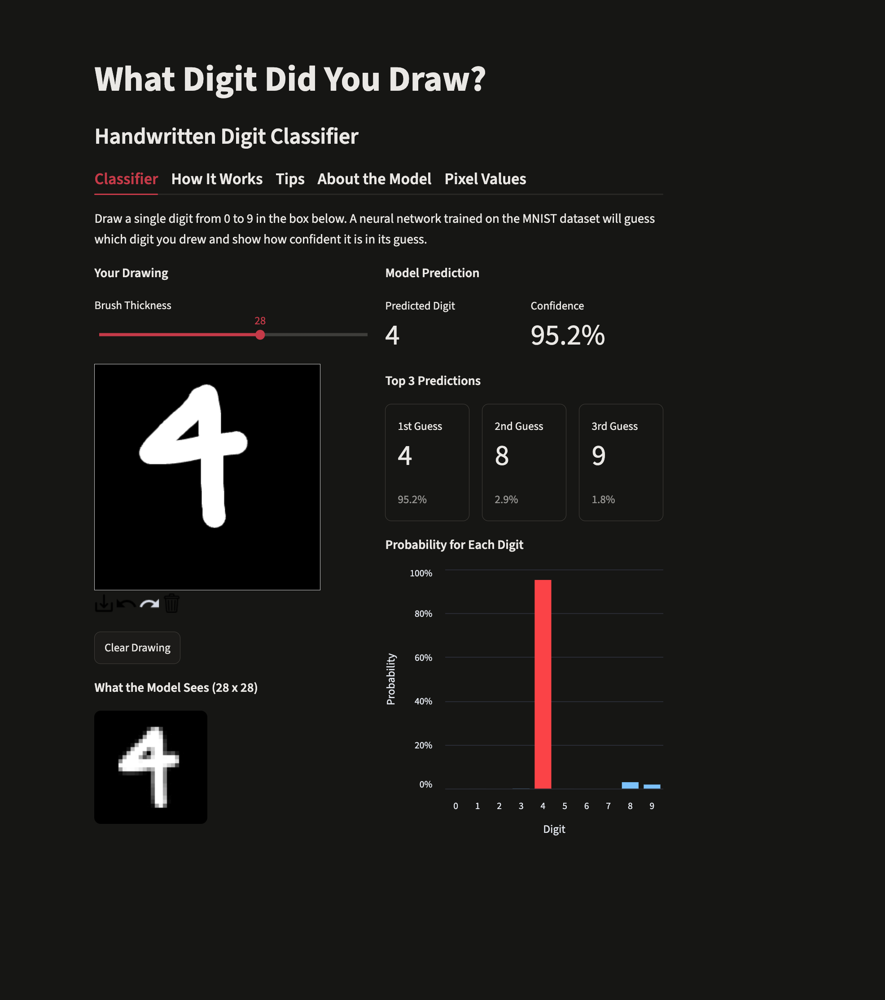
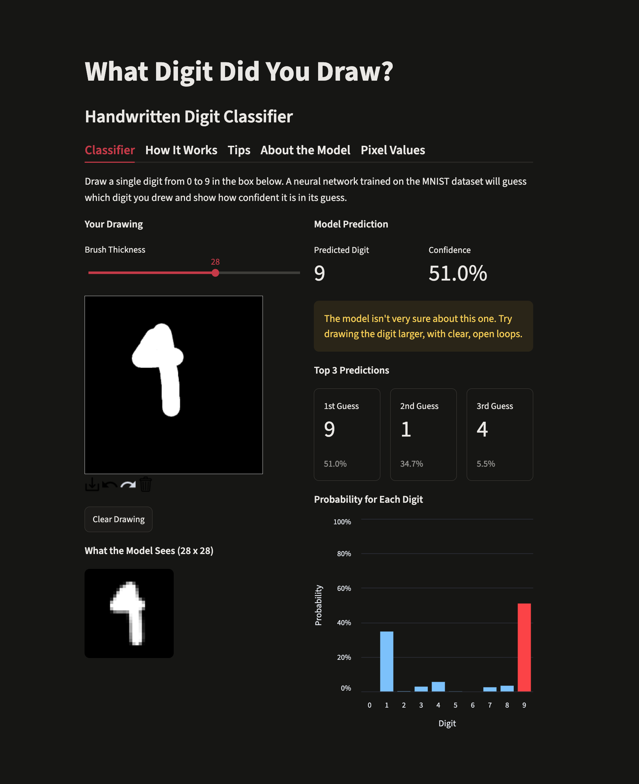
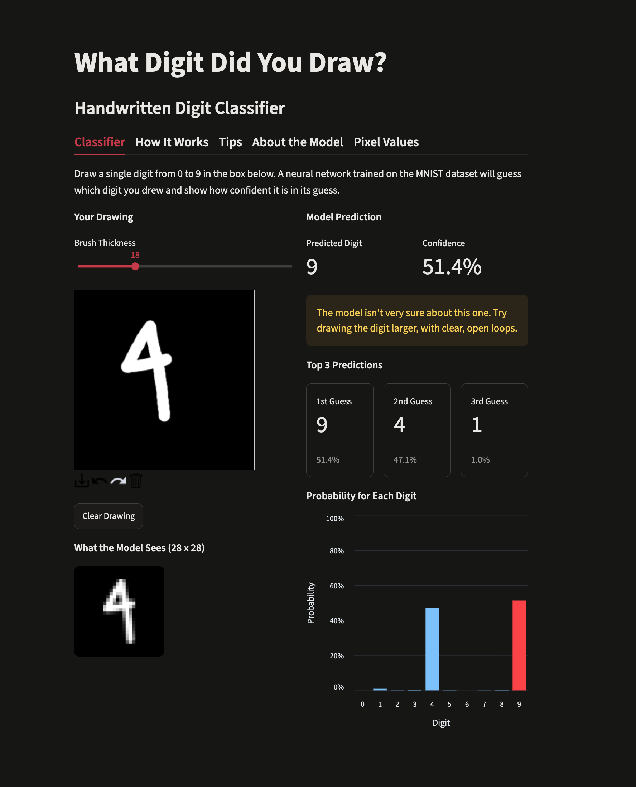
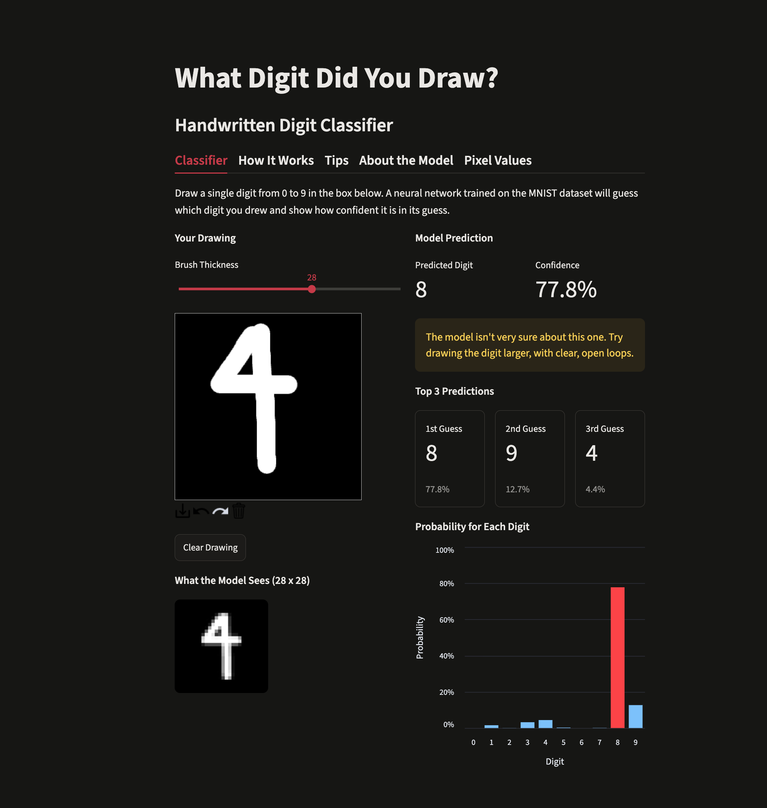

# What Digit Did You Draw?

A Streamlit app that guesses which digit, from 0 to 9, you draw on the
screen. It uses a convolutional neural network (CNN) that I built and
trained on the [MNIST dataset](https://keras.io/api/datasets/mnist/) of handwritten digits. The app shows the model's prediction, how confident it is, and what your drawing looks like after it's been prepared for the model.

This is Mini-Project 2 for my AI and machine learning course at UBC.



## Features

### Classifier

- A drawing canvas with a Clear Drawing button
- A Brush Thickness slider (10 to 40), added after testing showed that
  thin strokes fade when shrunk to 28 x 28 and thick strokes can fill in
  small loops
- Preprocessing that crops, resizes, and centers the drawing to match the
  MNIST images
- The predicted digit and the model's confidence, side by side
- A warning when the model's confidence is below 80%
- The top 3 predictions, each with its probability
- A bar chart of the probability for every digit, with the predicted digit
  highlighted
- The 28 x 28 image the model actually sees, shown under the drawing

### Other Tabs

- **How It Works:** a step-by-step walk through how the drawing is
  prepared and how each layer of the CNN turns it into a prediction,
  including the shape of the data at each step
- **Tips:** how to draw for the most accurate predictions
- **About the Model:** how the model was trained and tested, plus a
  confusion matrix showing which digits it mixes up most often across
  10,000 test images
- **Pixel Values:** the normalized value (0 to 1) of every pixel in the
  28 x 28 image, shaded from black to white

## Repository Structure

- `app.py` contains the Streamlit app
- `train_model.py` trains the CNN and saves it
- `digit_classifier.keras` contains the trained model
- `requirements.txt` lists the packages and exact versions the app needs
- `images/` contains the screenshots used in this README
- `LICENSE` contains the MIT license

## Environment and Setup

1. Create and activate a Conda environment:

```bash
conda create -n digit-classifier python=3.11
conda activate digit-classifier
```

2. From the project folder, install the packages:

```bash
pip install -r requirements.txt
```

3. Run the app:

```bash
streamlit run app.py
```

The app opens in your browser at `http://localhost:8501`.

The trained model is included, so you don't need to retrain it. To train
it again from scratch, run:

```bash
python train_model.py
```

## How It Works

### Preprocessing

The canvas saves each drawing as a 280 x 280 colour image. Before the
model sees it, the app:

1. Converts it to grayscale
2. Crops away the empty space around the digit
3. Shrinks the digit so its longest side is 20 pixels
4. Centers it in a 28 x 28 black image, the same way MNIST digits are
   centered
5. Divides every pixel by 255, so each value falls between 0 and 1
6. Reshapes it to (1, 28, 28, 1), the shape the model expects

### The Model

| Layer | What It Does | Output Shape |
|---|---|---|
| Input | The 28 x 28 grayscale image | 28 x 28 x 1 |
| Conv2D (16 filters) | Finds simple patterns, like edges | 26 x 26 x 16 |
| MaxPooling2D | Keeps the strongest signal in each 2 x 2 area | 13 x 13 x 16 |
| Conv2D (32 filters) | Combines them into more complex shapes | 11 x 11 x 32 |
| MaxPooling2D | Shrinks the image again | 5 x 5 x 32 |
| Flatten | Turns the grid into one list | 800 |
| Dense (64) | Weighs the patterns together | 64 |
| Dense (10, softmax) | One probability for each digit | 10 |

The model has 56,714 trainable parameters. It was trained for 3 epochs
with a batch size of 64, using the Adam optimizer and sparse categorical
crossentropy loss. It learned from 54,000 training images, with another
6,000 held back for validation.

On 10,000 test images it had never seen, it classified **98.4%**
correctly. The confusion matrix in the About the Model tab shows that its
most common mistakes were 9 predicted as 8 (21 times), 7 predicted as 2
(13 times), and 9 predicted as 4 (11 times). The hardest digit was 9, with
44 of 1,009 test images classified incorrectly.

## Testing Results

I drew the same digit, an open-top 4, in each of the five required styles.

| Test | Brush | Prediction | Confidence | 2nd Guess | 3rd Guess | Screenshot |
|---|---|---|---|---|---|---|
| Centered | 28 | 4 | 100.0% | 9 (0.0%) | 1 (0.0%) |  |
| Corner | 28 | 4 | 52.4% | 9 (38.6%) | 8 (6.3%) |  |
| Thin | 10 | 4 | 99.2% | 1 (0.2%) | 7 (0.2%) |  |
| Thick | 40 | 4 | 100.0% | 7 (0.0%) | 9 (0.0%) |  |
| Messy | 28 | 4 | 99.2% | 9 (0.7%) | 7 (0.1%) |  |

All five were predicted correctly.

**The corner test was the hardest.** Centering fixed the position, but I
also drew it small. To make it 20 pixels tall, the app had to enlarge it,
which made the thick strokes blobby and filled in the open top. The model
then saw something closer to a 9, and the low-confidence warning appeared.
This test ended up measuring size more than position.

**Thin and thick strokes both worked well** once the drawing was large.
Messy strokes didn't matter either, as long as the key parts of the 4 were
there.

### Edge Cases: Closed-Top 4s

Since mixing up 4 and 9 is one of the model's most common mistakes, I also
tested 4s with a closed, triangular top.

| Case | Brush | Prediction | Confidence | 2nd Guess | 3rd Guess | Screenshot |
|---|---|---|---|---|---|---|
| Large triangle | 28 | 4 | 95.2% | 8 (2.9%) | 9 (1.8%) |  |
| Tiny top, tall and narrow | 28 | 9 | 51.0% | 1 (34.7%) | 4 (5.5%) |  |
| Small triangle | 18 | 9 | 51.4% | 4 (47.1%) | 1 (1.0%) |  |
| Closed top, long crossbar | 28 | 8 | 77.8% | 9 (12.7%) | 4 (4.4%) |  |

- **What decided the result was whether the hole survived shrinking.**
  When the triangle was big enough, a dark hole stayed visible in the
  28 x 28 image and the model got it right. When the hole filled in, the
  top looked like the solid head of a 9 or the loop of an 8.
- **Small changes can flip the answer.** The first and last drawings look
  similar, but one scored 95.2% as a 4 and the other 77.8% as an 8.
- **The warning caught every wrong answer here, but it isn't a guarantee.**
  During earlier testing, a closed-top 4 was predicted as an 8 with 94.9%
  confidence. A wrong answer that confident would not trigger the warning.

## Reflection

### How does a computer represent a handwritten digit as data?

As a grid of numbers. Each pixel is one number for its brightness, from 0
for black to 255 for white in grayscale. A 28 x 28 image is 784 numbers.
The model never sees a shape the way we do, only these numbers and the
patterns between them.

### Why is the image resized to 28 x 28?

Because that's the size of every image in MNIST, so it's the shape the
model was built and trained on. The input layer expects exactly
28 x 28 x 1, so any other size causes an error. My preprocessing also
fits the digit into a 20 x 20 box and centers it, because that's how the
MNIST digits were prepared.

### Why are the pixel values normalized from 0 to 1?

The model was trained on pixel values divided by 255, so the drawing has
to be prepared the same way. If it weren't, every value would be up to 255
times larger than what the model learned from. Small values on the same
scale also make training more stable, since the weights don't have to
adjust to very large numbers.

### What does the confidence score represent?

It's the softmax probability of the top prediction: how strongly the
drawing matches the patterns the model learned for that digit, compared
with the other nine. It is not the chance that the answer is correct. My
testing showed this clearly, when a closed-top 4 was predicted as an 8
with 94.9% confidence.

### Which drawing was hardest for the model, and why?

4s with a small, closed top. When the drawing is shrunk to 28 x 28, the
small hole inside the triangle fills in, so the top looks like the solid
head of a 9 or the loop of an 8. Many MNIST 4s have an open top, so the
model learned to expect that shape. Small drawings were also harder,
because enlarging them made the strokes thick and blobby.

### What is the difference between training and inference?

Training is when the model learns. It looks at 54,000 labelled images,
compares its guesses to the right answers, and adjusts its weights to make
fewer mistakes. During training, I had control over the data, the layers,
and how long it learned.

Inference is when the trained model makes predictions on new data. The
weights are frozen, so the model applies what it already learned and
doesn't change. My app only does inference. It loads the saved model, and
the only thing a user controls is the drawing.

### What would you improve in the future?

- Train with data augmentation, like small rotations, shifts, and
  different stroke thicknesses, so the model handles more drawing styles
- Center the digit by its center of mass instead of its bounding box,
  which is closer to how MNIST was prepared
- Add a way to detect when a drawing isn't a digit at all, since the model
  always picks one of the ten
- Deploy the app online, and run the model directly in my portfolio site
  using TensorFlow.js

## Design Notes

- **Tabs instead of a sidebar:** the explanations live in tabs below the
  classifier rather than in a sidebar, because Streamlit hides the sidebar
  behind a menu on phones. The classifier is the first tab, so it's the
  first thing people see.
- **Caching:** the model loads once with `@st.cache_resource`, and the
  confusion matrix is calculated once with `@st.cache_data`, so the app
  doesn't redo slow work every time the drawing changes.
- **Canvas version:** `streamlit-drawable-canvas` is pinned to 0.9.3,
  because version 0.13.0 fails on import.
- **Starting point:** the model's structure is based on the Lesson 9
  example from the course. I built the app, preprocessing, and every
  feature from scratch.

## Acknowledgements

The MNIST dataset was created by Yann LeCun, Corinna Cortes, and
Christopher Burges, and is loaded in this project through Keras.

## License

This project is licensed under the MIT License. See `LICENSE` for details.